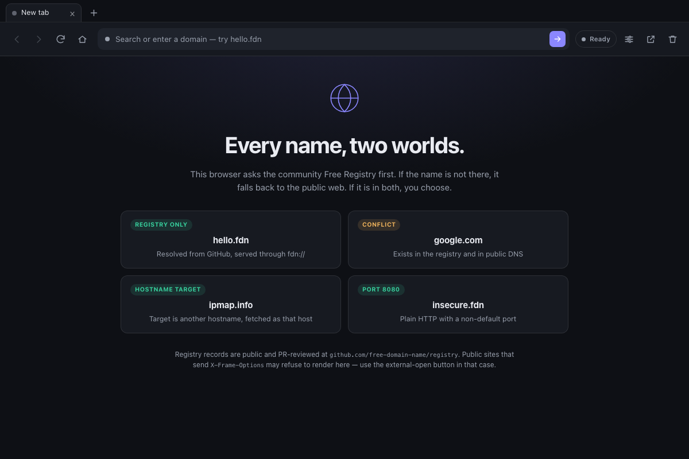

# Free Domain Browser

<p align="center">
  
</p>

A small cross-platform browser (desktop + Android) that resolves **any** name
through the community [Free Domain Name registry](https://github.com/free-domain-name/registry)
first, then falls back to public ICANN DNS. When a name exists in both places, it
asks the user which destination they want and remembers the answer for the
session.

Built with Tauri v2 (Rust + system webview) and a vanilla HTML/CSS/JS chrome.
Tabs, the address bar, history and the resolution status all live in the chrome;
on desktop each tab owns its own native child webview (Android uses an iframe) so
switching tabs keeps the page and its form state alive. The chrome uses a
BoxLayout-style split: the tab strip, toolbar and status bar are fixed, and the
page viewport takes all remaining height. It is GPLv3, open source, and has
light/dark, compact layouts, seven built-in skins and a custom CSS editor.

> **Disclaimer:** Registry names and destinations are public third-party
> submissions. The project does not operate, monitor or endorse them, and a
> record is not proof of ownership, safety or legality. Visit destinations at
> your own risk. Community scores and comments are opinions, not security
> audits. Read the
> [full registry disclaimer](https://github.com/free-domain-name/registry/blob/main/DISCLAIMER.md).

<p align="center">
  <strong><a href="https://free-domain-name.github.io/tauri-browser/">Documentation, quick start &amp; skin gallery &rarr;</a></strong>
</p>

<p align="center">
  <a href="https://free-domain-name.github.io/tauri-browser/">
    
  </a>
</p>

## Download

Prebuilt desktop packages are published from GitHub Actions:

- **macOS** — universal DMG for Apple Silicon and Intel
- **Windows x64** — MSI and NSIS installer
- **Linux x64** — AppImage and Debian package

Download the latest from
[GitHub Releases](https://github.com/free-domain-name/tauri-browser/releases/latest).
The builds are ad-hoc signed or unsigned and are not notarized, so macOS and
Windows may ask you to confirm the first launch. Android is currently built
from source.

## How resolution works

```
address bar
    │
    ▼
parse input ──► registry lookup (memory → disk → raw.githubusercontent.com)
    │                         │
    │                         ├── no record ──► .fdn or public NXDOMAIN ──► CLAIM PAGE
    │                         │                └── delegated public name ───► public https://
    │                         │
    │                         └── record ──► is public DNS delegated?
    │                                           │
    │                                           ├── yes ──► CONFLICT MODAL
    │                                           │             ├── registry → fdn://
    │                                           │             └── public   → https://
    │                                           │
    │                                           └── no ────► fdn:// (instant)
    ▼
render in the content view
```

The Rust side returns a **navigation plan** to the UI; the UI never performs DNS
or GitHub requests itself. Plans are one of:

| `kind`        | Meaning                                                        |
| ------------- | -------------------------------------------------------------- |
| `navigate`    | Load `url`; `source` is `github_registry` or `public_icann`.   |
| `unregistered`| A name is absent from the registry and public DNS (or is any `.fdn` miss). Show the claim page.|
| `conflict`    | Both exist. Show the modal and call `choose_resolution`.       |
| `unavailable` | GitHub could not be read. Retry, or opt into the public web.   |
| `error`       | Invalid input (for example a `javascript:` URL).               |

## Registry contract

One JSON file per name, fetched on demand from the raw CDN:

```text
https://raw.githubusercontent.com/free-domain-name/registry/main/e/x/a/m/example.com.json
https://raw.githubusercontent.com/free-domain-name/registry/main/t/e/s/t/test.xyz.json
```

```json
{
  "domain": "example.com",
  "target_url": "http://203.0.113.10:8080",
  "owner_github": "username",
  "ttl": 3600
}
```

`target_url` is an **origin**, not a page URL:
`http(s)://<ipv4 | [ipv6] | hostname>[:port]`. It has no credentials, path,
query or fragment; the browser appends the request path and query. The full
grammar, IP/hostname semantics and rejected forms live in
[the registry docs](https://github.com/free-domain-name/registry/blob/main/docs/target-url.md).

The shard path is the domain with dots removed, padded to four characters, split
one character per directory. A short name pads with `_` (`a.co` →
`a/c/o/_/a.co.json`). Four levels give 37⁴ buckets and keep directories small.

`target_url` can be an IP literal or a hostname; an IP is the simplest
registration and behaves like an A record for HTTP. Use `http://` for a bare
IP — HTTPS certificates are issued to names, not addresses (unless the
certificate has an IP SAN). A port and a path are optional.

`ttl` is the client cache lifetime in seconds. Records live in memory
(`Arc<RwLock<HashMap<String, CachedRecord>>>`) and in
`app_cache_dir()/registry/<shard path>`. Negative (404) results are cached for
5 minutes. A stale positive record is served if GitHub is temporarily
unreachable.

There is deliberately **no `client.json`** and no global index: a single generated
index was the previous iteration and does not scale.

## Custom protocol proxying

Tauri cannot register `http`/`https` as custom schemes or globally intercept every
webview request. Registry destinations are therefore served through the `fdn`
scheme:

| Platform        | URL the webview loads      | Request the Rust handler sees |
| --------------- | -------------------------- | ----------------------------- |
| macOS / Linux / iOS | `fdn://example.com/path` | `fdn://example.com/path`      |
| Windows / Android   | `http://fdn.example.com/path` | `fdn://example.com/path`  |

Tauri maps the workaround URL and reverts it before calling
`register_asynchronous_uri_scheme_protocol`. The handler then:

1. looks the name up in the registry (cache first),
2. requests `target_url` with the requested path. A **hostname target** is
   fetched as itself, so CDNs and normal virtual hosts see the site they serve;
   an **IP-literal target** receives the registry name as `Host`, so one address
   can virtual-host many free names,
3. follows redirects internally (max 5),
4. strips framing/CSP headers so the page can render in the content view,
5. rewrites absolute URLs for the registry name and the target host to the
   proxy scheme, so links, CSS, images and JS keep flowing through the
   interceptor,
6. injects a tiny bridge script that reports the full in-page URL and title to
   the chrome. The chrome updates the address bar, tab title and history entry;
   `pushState`/`replaceState`, `popstate`, hash changes, link clicks and title
   mutations are all observed.

Public fallback pages are loaded over normal `https://` and are not proxied.

### Available names

The registry is not limited to `.fdn`; it can hold a record for **any** hostname,
including names under standard TLDs. The browser only offers the claim page when
the name is genuinely absent:

- A `.fdn` miss is always available: `.fdn` is the registry's own namespace, so
  public DNS is not consulted.
- For every other name, the browser asks public DNS for NS records. A definitive
  **NXDOMAIN** means the name is not delegated and can be claimed. A delegated
  name falls through to the public web, and a timeout or inconclusive answer is
  never treated as available.

The claim page works for any hostname and shows the exact shard path, an IP-first
JSON template, and buttons to open the registry's GitHub "new file" flow with
that JSON prefilled. It also has a **Copy JSON** button, so the formatted record
can be pasted if GitHub's editor flattens the prefilled text. After the pull
request merges, the re-check button clears the negative cache and resolves the
name normally.

Claiming a public-TLD name creates a **Free Domain Registry mapping**; it does
not buy the ICANN registration. If that public domain becomes active later, the
browser shows visitors the conflict chooser. A name in both the registry and
public DNS also shows the conflict modal.

## Project layout

```text
assets/icon.svg          app icon source (open-orbit universe)
docs/                    static GitHub Pages documentation and screenshots
ui/                      browser chrome (tabs, address bar, history, claim, modal)
ui/appearance.js         theme + density + skin bootstrap (before first paint)
ui/skins.css             seven built-in chrome palettes and textures
src-tauri/
  Cargo.toml
  tauri.conf.json
  capabilities/default.json
  icons/
  src/
    lib.rs               Tauri entry point, commands, shared state
    registry.rs          sharded fetcher + memory/disk cache
    resolver.rs          input parsing, registry/public plan, conflict detection
    proxy.rs             fdn:// handler, redirects, header/HTML rewriting
    browser.rs           desktop child webviews, bounds/focus commands, native menu
    error.rs             serializable error type
```

## Commands

| Command                        | Description                                    |
| ------------------------------ | ---------------------------------------------- |
| `navigate(input)`              | Resolve an address-bar input into a plan.      |
| `choose_resolution(domain, path, choice)` | Remember `registry`/`public` and return the URL. |
| `forget_resolution(domain)`    | Forget a session choice.                       |
| `clear_registry_cache()`       | Drop memory and disk registry caches.          |
| `open_external(url)`           | Send an http(s) URL to the system browser.     |
| `browser_info()`               | Version, proxy base, registry base, platform.  |

On a conflict the Rust command also emits the `conflict-detected` event with the
same payload.

## Tabs and keyboard

`Ctrl/Cmd+T` opens a tab, `Ctrl/Cmd+W` closes the active one, `Ctrl/Cmd+L`
focuses the address bar, `Ctrl/Cmd+R` reloads, and `Ctrl+Tab` cycles tabs.
`Cmd+[`/`Cmd+]` walk history on macOS; elsewhere use `Alt+Left`/`Alt+Right`.
Middle-clicking a tab closes it. Tabs are intentionally in-memory; a restart
starts with one new tab.

Desktop pages are native child webviews with their own keyboard focus, so the
shortcuts are also installed as native menu commands. The menu forwards each
command to the chrome, which keeps the page's own text input working.

The gear (or `Ctrl/Cmd+,`) opens **Appearance**:

- **Theme** — System (follows the desktop), Light, or Dark.
- **Layout** — Comfortable or Compact. Compact tightens tabs, toolbar, start
  page and claim page without shrinking the page content itself. The chrome is
  measured as fixed top boxes, an elastic page viewport and a fixed status bar;
  CSS templates can adjust the maximum heights with
  `--tabstrip-max-height`, `--toolbar-max-height` and
  `--statusbar-height`.
- **Skin** — Default plus six built-in looks: High-Tech, Futuristic, Historic,
  Victorian, Amazon and Terminal. Every skin has a light and dark palette, so
  the theme choice still works underneath it.
- **Write your own CSS** — a local CSS editor that applies after the selected
  skin. It can restyle the chrome, tabs, start page and settings panel; page
  content lives in a separate native view (or iframe on Android) and is isolated
  and unaffected.

All appearance choices are stored in `localStorage` for this device and applied
before the first paint, so a dark theme does not flash light. The menu also has a
reset that clears the theme, density, skin and custom CSS.

### Custom skin CSS

Open **Appearance → Write your own CSS**, paste CSS, then press **Apply CSS**
(or `Ctrl/Cmd+Enter`). The editor accepts up to 24,000 characters. It can use the
chrome's CSS tokens:

```css
:root {
  --accent: #ff5c8a;
  --accent-soft: rgba(255, 92, 138, 0.14);
  --on-accent: #170811;
  --radius: 2px;
}

.toolbar {
  background: #171018;
}

.start h1 {
  font-family: Impact, "Arial Black", sans-serif;
  text-transform: uppercase;
}
```

Useful selectors are `.toolbar`, `.tabstrip`, `.tab`, `.omnibox`, `.pill`,
`.statusbar`, `.statusbar-url`, `.start`, `.sample` and `.settings-menu`. The
main tokens are `--bg`, `--surface`, `--surface-2`, `--text`, `--muted`,
`--accent`, `--accent-soft`, `--on-accent`, `--radius`, `--sans`, `--mono`,
`--tabstrip-max-height`, `--toolbar-max-height`, `--statusbar-height` and
`--statusbar-max-height`. It is applied after the built-in skin and
wins over the skin's tokens, including its dark palette. Custom CSS is stored
with the other appearance settings and is only interpreted by this device's
local chrome.

## Community chat

Chat is off by default and opt-in per tab. The toolbar speech-bubble button
opens a side panel in local browser chrome; remote pages never receive IPC or
chat events. Hiding the last enabled panel drops the endpoint and stops
traffic.

The first enable requires an 18+ confirmation. Messages and presence are signed
with an Ed25519 key stored in the OS keychain. History is in memory for this
session only; the server stores no messages. There are no DMs in v1.

The General lobby is `fdn:general:v1`. Production bootstrap defaults are
compiled into `chat/config.rs`. Override them for development with:

```bash
FDN_CHAT_RELAY_URL=http://127.0.0.1:28443 \
FDN_CHAT_LOBBY_ID=<server bootstrap lobby_node_id> \
npm run dev
```

A local `chat-bootstrap.json` in the app config directory is also accepted, and
`FDN_CHAT_LOBBY_ROOM` overrides the lobby name. Site rooms are deferred from
v1: gossip needs an already-joined bootstrap peer, and no privacy-preserving
discovery mechanism has been chosen. See `CHAT_PLAN2.md` §20 and
`fdn-chatd/docs/IMPLEMENTATION.md`.

## Build

Prerequisites: Rust 1.82+, Node 18+, the platform's Tauri system dependencies,
and for Android the Android SDK/NDK plus `cargo tauri android init`.

```bash
npm install
npm run dev                 # desktop dev
npm run build               # desktop bundle
npm run android:init        # once, generates src-tauri/gen/android
npm run android:dev
npm run android:build
```

The webview loads `ui/` directly; there is no bundler or dev server.

### Releases

The release workflow lives in `.github/workflows/release.yml` and runs on a
`v*` tag. It builds a universal macOS DMG, Windows x64 MSI/NSIS installers, and
Linux x64 AppImage/.deb packages, then publishes them to GitHub Releases. The
tag must match the version in `src-tauri/tauri.conf.json`; the workflow fails
early if it does not.

```bash
# after bumping both package.json and src-tauri/tauri.conf.json
git tag v0.1.0
git push origin v0.1.0
```

The macOS job uses an ad-hoc signature (`APPLE_SIGNING_IDENTITY=-`), which is
enough for local distribution but not notarization. Add Apple and Windows
signing secrets before treating these as trusted production installers.

The app icon is the open-orbit universe in `assets/icon.svg`. Regenerate every
platform size after editing it:

```bash
npm run icon
```

### Why `npm run dev` can rebuild everything

Cargo reuses `src-tauri/target` as long as the **target directory, `CARGO_HOME`,
toolchain, feature set and `RUSTFLAGS`** stay the same. A full dependency rebuild
is the signature of one of those changing — most often `CARGO_TARGET_DIR` being
set by an IDE or shell profile, or the target directory being deleted by a
cleaner.

`npm run dev` goes through `scripts/tauri.mjs`. It corrects an inherited
`CARGO_TARGET_DIR` that points somewhere other than `src-tauri/target` and
otherwise leaves Cargo's environment untouched. Do not delete
`src-tauri/target`; a warm debug tree is several gigabytes and is what makes
subsequent runs fast.

If a run still compiles the world, print the effective paths:

```bash
npm run doctor
```

It shows the target directory, `CARGO_HOME`, `RUSTFLAGS`, incremental mode,
cache size and the last debug binary. For verbose CLI output use
`npm run dev:verbose`.

### Android notes

- `http://fdn.<domain>` is intercepted by the Tauri webview client and never
  leaves the device. Android 9+ may still apply its cleartext policy before
  interception; if a request is blocked, set
  `android:usesCleartextTraffic="true"` in the generated
  `src-tauri/gen/android/app/src/main/AndroidManifest.xml`.
- The generated `gen/android` project is not committed; `npm run android:init`
  recreates it.
- Multi-webview layouts are not available on Android, which is why the content
  view is an iframe (see limitations).

## Community reviews and scores

The project [home page](https://free-domain-name.github.io/) publishes a rolling
seven-day leaderboard and the names that still need a review. The documentation
site has a [Stumble page](https://free-domain-name.github.io/tauri-browser/stumble.html)
that picks a random registry name and embeds its public GitHub Discussion with
[giscus](https://giscus.app). Votes are 👍/👎 reactions on the discussion;
comments are normal GitHub comments inside the embedded thread. The
`reviews/index.json` snapshot is generated by the registry's
`Sync community reviews` workflow. The giscus app must be installed once on the
registry for the inline thread to load.

On a registry page, the desktop app shows 👍/👎 counts in its toolbar. Clicking
either opens a dedicated review window with the same inline thread, so a GitHub
sign-in cannot navigate away from the browser chrome or its open tabs.

**Human-written only.** No AI-generated domain lists, comments or reviews, and
no automated bulk promotion. This is a community rule enforced by moderation,
not a technical proof of authorship. A score is the share of positive votes
among recorded votes, and can be stale, incomplete or manipulated. See the
[registry disclaimer](https://github.com/free-domain-name/registry/blob/main/DISCLAIMER.md)
and [review rules](https://github.com/free-domain-name/registry/blob/main/reviews/README.md).

## Security model

- The main window (local chrome) has `core:default` and `opener:default`.
  Remote pages render in separate native child webviews on desktop and in
  cross-origin iframes on Android. Neither is granted Tauri IPC capabilities.
- The review window is a separate remote webview with no IPC capability. It
  loads the public Stumble page and keeps GitHub OAuth contained there; the
  browser chrome and open tabs are not replaced by the sign-in flow.
- Registry records are trusted input for routing, not for code execution: the
  proxy fetches the target over HTTP(S) and treats the body as untrusted.
- The proxy strips `Content-Security-Policy`, `X-Frame-Options`,
  `Cross-Origin-Opener-Policy` and `Cross-Origin-Embedder-Policy` from proxied
  responses so a destination can render inside the content view. This means a
  malicious destination loses those protections **inside this browser**; only
  visit names you trust.
- `target_url` must be an `http(s)` origin with no credentials, path, query or
  fragment; the browser validates this too. The registry validator rejects
  wildcards, loops, paths and unknown fields.
- HTTPS targets use `rustls` with normal certificate validation. There is no
  "ignore certificate errors" switch.
- Cookies are passed through, but `Domain=` and `Secure` attributes are dropped
  because the proxy origin is `fdn.<domain>` / `fdn://`. Sessions may not survive
  on every platform.

### Automated security checks

The [security workflow](.github/workflows/security.yml) runs on pushes to
`main`, pull requests, and a weekly schedule:

- **Snyk Open Source** checks the npm dependency tree.
- **Snyk Code** checks the JavaScript chrome for code issues.
- **`npm audit --audit-level=high`** is an always-on baseline for high and
  critical npm advisories.
- **RustSec** checks `src-tauri/Cargo.lock` for vulnerable Rust dependencies.

Snyk needs a repository secret named `SNYK_TOKEN` (Snyk account settings → API
token). Add it under **Settings → Secrets and variables → Actions**. Until it is
configured, the Snyk steps are skipped with a workflow warning; `npm audit` and
RustSec still run. The workflow uploads Snyk SARIF results to GitHub code
scanning when the secret is present.

Snyk Open Source does not scan Cargo manifests directly, so RustSec is used for
the desktop runtime and its Tauri/GTK dependency graph. Snyk Code's Rust support
is currently Enterprise-only; the free scan covers the JavaScript chrome.

Local equivalents:

```bash
npm audit --audit-level=high
cargo install cargo-audit --locked
cargo audit --file src-tauri/Cargo.lock
```

At the v0.1.0 baseline, `npm audit` reports no vulnerabilities and RustSec
reports no vulnerabilities. RustSec also prints informational unmaintained and
unsound advisories from the Linux GTK stack; they are surfaced by the workflow,
not suppressed.

## Known limitations (v1)

- **Framing (Android only):** the Android build renders content in an iframe, so
  public sites that send `X-Frame-Options`/`frame-ancestors` refuse to load;
  use the external-open button there. Desktop tabs use native child webviews and
  are not subject to `frame-ancestors`. Registry destinations are unaffected on
  both because the proxy strips those headers.
- **Interception scope:** only navigations that go through `fdn://` are proxied.
  A page on the public web that links to a registry name goes to the public web
  until the address bar is used again.
- **Buffered responses:** Tauri's URI-scheme responder needs a complete body, so
  large downloads and video are buffered up to 64 MiB. Streaming needs a
  different transport (local proxy or range-aware response).
- **Redirects:** followed inside the proxy, up to five. The final page is served
  under the registry name, so absolute links to a different host leave the proxy
  and are not tracked in the address bar.
- **History:** the chrome tracks address-bar navigations and main-frame page
  loads reported by the desktop webview, per tab. On Android the bridge reports
  registry in-page navigations. Script-driven URL changes (`pushState`) do not
  update the address bar on desktop, and link clicks inside public iframes
  cannot be observed on Android because they are cross-origin.
- **Tabs:** on desktop each tab is a native child webview (Tauri multiwebview)
  with no Tauri IPC, so sites that block framing still render. Android keeps the
  iframe fallback described above.
- **No wildcard records:** the current registry schema is exact-name only.
- **Session choices** are in memory and disappear when the app exits.

## Tests

```bash
cd src-tauri && cargo test --lib
```

The unit tests cover shard-path derivation (Rust and Node must agree), input
parsing, the unregistered-name branch, URL rewriting, cookie sanitization, the
bridge and error-page escaping. The `#[ignore]` live tests check the real registry
and DNS, including an unregistered public `.com` and a registered public name:

```bash
cd src-tauri && cargo test --lib -- --ignored
```

The registry validates itself with:

```bash
cd /path/to/registry && node scripts/validate.mjs
```

## License

Free Domain Browser is **GPL-3.0-only**. The full text is in [LICENSE](LICENSE).
The registry, browser and their scripts are distributed under the same license;
the app metadata (`Cargo.toml`, `package.json`, Tauri bundle settings) declares
it as well.

### Is GPLv3 compatible with Tauri?

Yes. Tauri is dual-licensed **MIT OR Apache-2.0**. Both are permissive and
GPLv3-compatible, so this application can be GPLv3 and redistribute Tauri inside
it. Tauri's own source stays under its license; the combined application is
distributed under GPLv3. The remaining Rust and npm dependencies are permissive
(MIT, Apache-2.0, BSD, ISC, MPL-2.0, CDLA-Permissive-2.0); MPL-2.0 is
GPLv3-compatible. Keep the upstream copyright and license notices when shipping
binaries.

GPLv3 requires providing the corresponding source for binaries you distribute.
Publishing releases from this repository satisfies that. The license text is
also bundled with the application (`Contents/Resources/LICENSE` in the macOS
app). Direct distribution (GitHub Releases, F-Droid, etc.) is fine; Apple's App
Store adds DRM and terms that may conflict with GPLv3, so review that before an
iOS/Mac App Store release.
